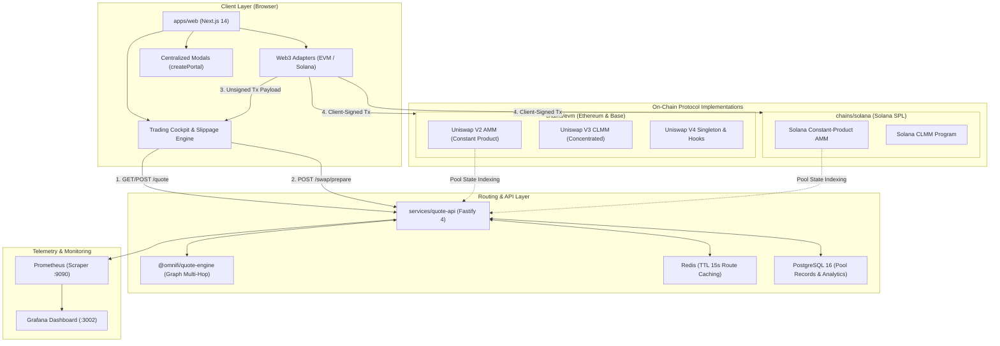

# OmniFi (Ω)

> **High-Precision, Non-Custodial Multi-Chain Decentralized Exchange**  
> Independently engineered native protocol implementations across **Ethereum**, **Base**, and **Solana**, unified by an algorithmic routing engine and cyber-industrial trading cockpit.

[](https://github.com/omnifi/omnifi)
[](file:///Users/majedurrahman/coding/OmniFi/docker-compose.yml)
[](file:///Users/majedurrahman/coding/OmniFi/chains/evm)
[](file:///Users/majedurrahman/coding/OmniFi/chains/solana)
[](file:///Users/majedurrahman/coding/OmniFi/apps/web)
[](file:///Users/majedurrahman/coding/OmniFi/docs/adr/ADR-011-admin-custody.md)
[](LICENSE)

---

## Table of Contents

- [1. Executive Summary](#1-executive-summary)
- [2. Core Architectural Principles](#2-core-architectural-principles)
- [3. System Architecture](#3-system-architecture)
- [4. Supported Chains & AMM Engines](#4-supported-chains--amm-engines)
- [5. Repository Structure](#5-repository-structure)
- [6. Component Deep Dive](#6-component-deep-dive)
  - [On-Chain Protocols (EVM & Solana)](#on-chain-protocols-evm--solana)
  - [Algorithmic Quote Engine](#algorithmic-quote-engine)
  - [Quote & Routing API](#quote--routing-api)
  - [Web Frontend & Trading Cockpit](#web-frontend--trading-cockpit)
- [7. Quickstart & Local Development](#7-quickstart--local-development)
  - [Prerequisites](#prerequisites)
  - [One-Command Docker Deployment](#one-command-docker-deployment)
  - [Bare-Metal Monorepo Development](#bare-metal-monorepo-development)
- [8. Docker Ecosystem & Port Matrix](#8-docker-ecosystem--port-matrix)
- [9. REST API Reference](#9-rest-api-reference)
- [10. Testing & Verification Playbook](#10-testing--verification-playbook)
- [11. Security & Cryptographic Invariants](#11-security--cryptographic-invariants)
- [12. Architecture Decision Records (ADRs)](#12-architecture-decision-records-adrs)
- [13. License](#13-license)

---

## 1. Executive Summary

**OmniFi** is an enterprise-grade decentralized exchange (DEX) engineered from the ground up for zero-compromise trading and liquidity management. Rather than relying on fragile cross-chain bridges or synthetic wrapped abstractions, OmniFi deploys **native, independently engineered protocol implementations** directly onto each supported chain:

1. **EVM Chains (Ethereum Mainnet & Base)**: Native Solidity contracts written in Foundry covering Uniswap V2 constant-product AMM, Uniswap V3 concentrated liquidity (CLMM), and Uniswap V4 hooks.
2. **Solana**: Native Rust/Anchor programs featuring low-latency constant-product AMMs and concentrated liquidity pools with SPL Token-2022 compatibility.

All pools feed into an off-chain algorithmic **Quote Engine** that computes optimal trade routes, multi-hop splits, and precise price impact estimates. Users interact through a unified, high-performance web cockpit built with Next.js 14 and an obsidian-cyber industrial design system.

---

## 2. Core Architectural Principles

- **Decoupled Key Management ([ADR-011](file:///Users/majedurrahman/coding/OmniFi/docs/adr/ADR-011-admin-custody.md))**: OmniFi services **never hold, manage, or proxy private keys**. The backend only prepares unsigned transaction payloads. Signing is exclusively executed client-side inside the user's browser wallet (MetaMask, Coinbase Wallet, Phantom).
- **Zero Floating-Point Math**: All financial computations, tick math, invariant equations, and fee splits use strict integer fixed-point math (`bigint` in TypeScript, `uint256` in Solidity, `u128`/`u64` in Rust).
- **Multi-Tier Transaction Lifecycle (§26.4)**: Real-time user feedback tracking transactions through the exact state machine:  
  `Idle` ➔ `Preparing` ➔ `Submitting` ➔ `Submitted` ➔ `Confirmed` ➔ `Finalized` (or `Failed`).
- **Resilient Route Discovery**: Multi-hop pathfinding utilizing Bellman-Ford and Dijkstra algorithms to find maximum output paths and multi-route percentage splits while enforcing price impact threshold barriers (warning at $\ge 1\%$, mandatory confirmation at $\ge 5\%$).
- **Centralized React Portals**: All modal overlays (Wallet Modal, Token Selector) are dynamically mounted to `document.body` via React Portals, guaranteeing viewport centering without containing-block clipping from sticky headers or CSS `backdrop-filter` ancestors.

---

## 3. System Architecture

The following diagram illustrates the complete OmniFi end-to-end architecture:



---

## 4. Supported Chains & AMM Engines

| Chain / Network | CAIP-2 ID | Protocol Engines | Native Asset | Supported Token Standards |
|---|---|---|---|---|
| **Ethereum Mainnet** | `eip155:1` | Uniswap V2, Uniswap V3 CLMM, Uniswap V4 Hooks | ETH (18 dec) | ERC-20, WETH |
| **Base** | `eip155:8453` | Constant Product V2, Concentrated CLMM | ETH (18 dec) | ERC-20, USDbC |
| **Solana Mainnet-Beta** | `solana:mainnet-beta` | Solana CP-AMM, Solana CLMM | SOL (9 dec) | SPL Token, SPL Token-2022 |

---

## 5. Repository Structure

```
OmniFi/
├── apps/
│   └── web/                     # Next.js 14 web app (Trading Cockpit, Pools, Tokens, Positions)
├── packages/
│   ├── api-client/              # Universal TypeScript SDK client for Quote API
│   ├── config/                  # Shared network constants, RPCs, and chain metadata
│   ├── database/                # Drizzle ORM schemas and PostgreSQL migrations
│   ├── domain/                  # Shared entities, value objects, and RFC 7807 error types
│   ├── eslint-config/           # Monorepo-wide ESLint rule presets
│   ├── prettier-config/         # Opinionated Prettier formatting rules
│   ├── quote-engine/            # Graph pathfinding, split routing, and invariant math
│   ├── rpc-resilience/          # Failover RPC connection pooling and health checking
│   ├── sdk-evm/                 # EVM contract call encoders and ABI artifacts
│   ├── sdk-solana/              # Anchor instruction builders and account decoders
│   ├── sdk-unified/             # Unified multi-chain provider interface
│   ├── test-vectors/            # Shared cross-chain test vectors and golden datasets
│   └── token-registry/          # Curated multi-chain token metadata & risk tiers
├── chains/
│   ├── evm/                     # Foundry Solidity contracts (V2, CLMM, V4, Vaults)
│   └── solana/                  # Anchor/Rust programs (CP-AMM, CLMM)
├── services/
│   ├── quote-api/               # Fastify REST API daemon with Swagger & Prometheus
│   ├── indexer-evm/             # EVM blockchain block and event ingestion daemon
│   ├── indexer-solana/          # Solana account websocket subscriber
│   ├── notification-worker/     # Webhook & user alert notification worker
│   └── reconciliation-worker/   # On-chain reserves integrity reconciliation
├── infra/
│   ├── docker/                  # Dockerfiles and service build definitions
│   └── monitoring/              # Prometheus alerts and Grafana dashboards
├── scripts/
│   ├── test-docker-stack.sh     # Comprehensive 17-point container integration test
│   ├── test-ui-full.mjs         # Headless Chromium DevTools Protocol (CDP) test suite
│   ├── chaos-rehearsal.sh       # Chaos fault injection & recovery test runner
│   ├── chaos-rehearsal.ts       # RPC partition & database failure verification
│   └── hash-artifacts.sh        # SHA-256 build verification script
├── docs/
│   ├── plan.md                  # Comprehensive 15-phase implementation specification
│   ├── requirements-traceability.csv # Requirements to code & test mapping
│   └── adr/                     # 15 Architectural Decision Records (ADRs)
└── docker-compose.yml           # Multi-container orchestration stack
```

---

## 6. Component Deep Dive

### On-Chain Protocols (EVM & Solana)
- **EVM Contracts ([`chains/evm`](file:///Users/majedurrahman/coding/OmniFi/chains/evm))**:
  - Developed with Foundry (`forge 0.2.0`).
  - Strict reentrancy protections (`ReentrancyGuardUpgradeable`), custom error signatures for minimal gas overhead, and explicit flash-loan invariant barriers.
  - Full concentrated liquidity tick-math implementation with $Q64.96$ fixed-point arithmetic.
- **Solana Programs ([`chains/solana`](file:///Users/majedurrahman/coding/OmniFi/chains/solana))**:
  - Built with the Anchor Framework (`0.30+`).
  - Program Derived Addresses (PDAs) for authority-free vault management (`seeds = [b"amm", pool.key().as_ref()]`).
  - Complete protection against front-running and slippage manipulation via explicit limit constraints.

### Algorithmic Quote Engine
- Located in [`packages/quote-engine`](file:///Users/majedurrahman/coding/OmniFi/packages/quote-engine).
- Represents liquidity networks as directed acyclic multigraphs (DAMG).
- Features **Split-Path Routing**: when single-route slippage exceeds optimal curves, the engine splits trade volume across parallel paths (e.g., $70\%$ direct pool, $30\%$ multi-hop route) to maximize net output tokens.
- Strict $bps$ (basis points) calculations preventing integer division truncation.

### Quote & Routing API
- Located in [`services/quote-api`](file:///Users/majedurrahman/coding/OmniFi/services/quote-api).
- Built on Fastify 4 for microsecond-latency request handling.
- **Resilient Unified Route**: accepts both `POST` payloads and `GET` queries (with query normalization and cache-busters).
- RFC 7807 Problem Details for all validation and business errors.
- Built-in Prometheus metrics (`/metrics`), Swagger UI (`/documentation`), and live system health (`/health`).

### Web Frontend & Trading Cockpit
- Located in [`apps/web`](file:///Users/majedurrahman/coding/OmniFi/apps/web).
- Built with **Next.js 14** (React 18, App Router).
- **Obsidian-Cyber Theme**: custom design system in [`terminal.css`](file:///Users/majedurrahman/coding/OmniFi/apps/web/src/styles/terminal.css) utilizing deep void backgrounds (`#06070a`), frosted glass cards (`rgba(15, 19, 26, 0.85)`), and cyber emerald accents (`#00e599`).
- **Interactive Views**:
  - `/` (Swap Cockpit): Token flip, slippage selector (0.1%, 0.5%, 1.0%), real-time quote refresh, and multi-tier lifecycle progress.
  - `/pools`: Filterable liquidity directory with live TVL, reserve states, and fee tiers.
  - `/pools/[network]/[poolId]`: Deep pool telemetry inspector.
  - `/tokens`: Verified multi-chain asset registry with security risk classifications (LOW, MEDIUM, HIGH).
  - `/positions`: Concentrated liquidity LP manager with one-click fee harvest.
  - `/status`: Real-time node connectivity, RPC latency, and global protocol telemetry.
  - `/history`: Local audit trail of signed on-chain transactions and finality states.

---

## 7. Quickstart & Local Development

### Prerequisites

Ensure the following tools are installed on your host machine:

- **Node.js**: `v20.0.0` or higher (Node 22 recommended)
- **pnpm**: `v9.0.0` or higher (`corepack enable && corepack prepare pnpm@latest --activate`)
- **Docker & Docker Compose**: Docker Desktop 4.25+ or Docker Engine 24+
- **Foundry** (optional, for contract testing): `curl -L https://foundry.paradigm.xyz | bash && foundryup`
- **Rust & Cargo** (optional, for Solana testing): `curl --proto '=https' --tlsv1.2 -sSf https://sh.rustup.rs | sh`

---

### One-Command Docker Deployment

The fastest way to spin up the entire OmniFi ecosystem is via Docker Compose:

```bash
# 1. Clone the repository
git clone https://github.com/omnifi/omnifi.git
cd OmniFi

# 2. Start the full 7-service stack in detached mode
docker compose up -d --build

# 3. Verify all containers are healthy
docker compose ps
```

Once running, access the local environments:
- **Trading Cockpit (Web UI)**: [http://localhost:3000](http://localhost:3000)
- **Fastify Quote API**: [http://localhost:3001/health](http://localhost:3001/health)
- **API Swagger Documentation**: [http://localhost:3001/documentation](http://localhost:3001/documentation)
- **Grafana Monitoring**: [http://localhost:3002](http://localhost:3002) (Login: `admin` / `admin`)
- **Prometheus Scraper**: [http://localhost:9090](http://localhost:9090)
- **Anvil EVM Node**: [http://localhost:8545](http://localhost:8545)

To shut down the stack:
```bash
docker compose down -v
```

---

### Bare-Metal Monorepo Development

For local code development across packages and applications:

```bash
# 1. Install all dependencies across monorepo workspaces
pnpm install

# 2. Build all packages and shared libraries
pnpm build

# 3. Start local Next.js frontend in development mode
pnpm --filter @omnifi/web dev

# 4. Start quote API in watch mode (requires local Redis & Postgres)
pnpm --filter @omnifi/quote-api dev
```

---

## 8. Docker Ecosystem & Port Matrix

| Service Container | Image / Dockerfile | Exposed Port | Purpose / Role | Healthcheck Endpoint |
|---|---|---|---|---|
| `omnifi-web` | `apps/web/Dockerfile` | `3000:3000` | Next.js 14 Production Web Application | `GET /` |
| `omnifi-quote-api` | `services/quote-api/Dockerfile` | `3001:3001` | Fastify Routing Daemon & Algorithmic Router | `GET /health` |
| `omnifi-grafana` | `grafana/grafana:10.3.3` | `3002:3000` | Observability & Telemetry Dashboards | `GET /api/health` |
| `omnifi-postgres` | `postgres:16-alpine` | `5432:5432` | Relational Storage for Pools, Tokens & Positions | `pg_isready` |
| `omnifi-redis` | `redis:7-alpine` | `6379:6379` | In-Memory Route Calculation & TTL Cache | `redis-cli ping` |
| `omnifi-anvil` | `trufflesuite/ganache:latest` | `8545:8545` | Local EVM Blockchain Node (Chain ID `31337`) | `HTTP GET /` |
| `omnifi-prometheus` | `prom/prometheus:v2.50.1` | `9090:9090` | Time-Series Metrics Ingestion Engine | `GET /-/healthy` |

---

## 9. REST API Reference

The Quote API serves high-frequency routing, transaction preparation, and telemetry.

### 1. Calculate Algorithmic Swap Quote
```http
POST /quote
Content-Type: application/json

{
  "tokenIn": "0xa0b86991c6218b36c1d19d4a2e9eb0ce3606eb48",
  "tokenOut": "0xc02aaa39b223fe8d0a0e5c4f27ead9083c756cc2",
  "amount": "100000000",
  "exactIn": true
}
```

*Response (`200 OK`):*
```json
{
  "quoteId": "quote-1793539672808-z452fn",
  "namespace": "eip155",
  "chainRef": "1",
  "tokenIn": "0xa0b86991c6218b36c1d19d4a2e9eb0ce3606eb48",
  "tokenOut": "0xc02aaa39b223fe8d0a0e5c4f27ead9083c756cc2",
  "amountIn": "100000000",
  "amountOut": "49849900599298204",
  "executionPrice": "498499005.992982",
  "priceImpact": {
    "bps": 30,
    "percentage": "0.30%",
    "level": "low"
  },
  "routes": [ ... ],
  "expiresAt": 1793539687808,
  "ttlMs": 15000
}
```

*Alternative Query Mode (`GET /quote`):*
```bash
curl "http://localhost:3001/quote?tokenIn=0xa0b86991c6218b36c1d19d4a2e9eb0ce3606eb48&tokenOut=0xc02aaa39b223fe8d0a0e5c4f27ead9083c756cc2&amount=100000000"
```

---

### 2. Prepare Unsigned Swap Transaction (ADR-011)
```http
POST /api/v1/swap/prepare
Content-Type: application/json

{
  "namespace": "eip155",
  "networkId": "eip155:1",
  "userAddress": "0x90F79bf6EB2c4f870365E785982E1f101E93b906",
  "protocol": "v2",
  "tokenIn": "0xa0b86991c6218b36c1d19d4a2e9eb0ce3606eb48",
  "tokenOut": "0xc02aaa39b223fe8d0a0e5c4f27ead9083c756cc2",
  "amountIn": "100000000",
  "minAmountOut": "49600000000000000"
}
```

*Response (`200 OK`):*
```json
{
  "preparedTransaction": {
    "to": "0x7a250d5630B4cF539739dF2C5dAcb4c659F2488D",
    "data": "0x38ed1739000000000000000000000000...",
    "value": "0",
    "chainId": 1,
    "estimatedGas": "150000"
  }
}
```

---

### 3. List Verified Tokens with Risk Tiers
```http
GET /api/v1/tokens?networkId=eip155:1&riskTier=LOW
```

---

### 4. Global Protocol Telemetry
```http
GET /api/v1/analytics/overview
```

*Response (`200 OK`):*
```json
{
  "networkId": "all",
  "totalTvlUsd": "595000000",
  "totalVolume24hUsd": "198333331",
  "totalFees24hUsd": "594999",
  "totalPools": 6,
  "totalSwaps24h": 750,
  "updatedAt": "2026-11-02T06:00:00.000Z"
}
```

---

## 10. Testing & Verification Playbook

OmniFi maintains strict verification standards with multi-tier automated test suites:

### 1. Automated Docker Full-Stack Verification
Runs end-to-end integration tests verifying every containerized service, database connection, Redis ping, Fastify metrics, and frontend route:
```bash
./scripts/test-docker-stack.sh
```
*Expected Output: `17 PASSED, 0 FAILED (ALL DOCKER SERVICES VERIFIED AND OPERATIONAL)`*

---

### 2. Headless Browser End-to-End Test Suite (CDP)
Launches headless Google Chrome via the Chrome DevTools Protocol to simulate real user interactions, verify live algorithmic quotes, test token inversion (⇅), execute wallet connection flows, test portal modal centering, and verify zero console errors:
```bash
node scripts/test-ui-full.mjs
```
*Expected Output: `23 PASSED, 0 FAILED, 0 CONSOLE ERRORS`*

---

### 3. Chaos & Invariant Verification Suite
Simulates sudden network partition failures, RPC failovers, and circuit-breaker triggers:
```bash
./scripts/chaos-rehearsal.sh
```

---

### 4. On-Chain Smart Contract Tests
```bash
# Run Foundry Solidity unit & invariant tests
pnpm test:evm

# Run Anchor Rust program tests
pnpm test:solana
```

---

## 11. Security & Cryptographic Invariants

OmniFi enforces non-negotiable security requirements throughout its codebases:

1. **Non-Custodial Guarantee ([ADR-011](file:///Users/majedurrahman/coding/OmniFi/docs/adr/ADR-011-admin-custody.md))**: Under no circumstances does any server or worker have access to private keys or custody over user funds. All state changes require client-side signature.
2. **Reentrancy Protection**: All EVM state transitions adhere to Checks-Effects-Interactions (CEI) with non-reentrant mutex locks on all liquidity pools and routers.
3. **Price Impact Circuit Breakers**: The UI and router enforce strict barriers preventing execution when price impact exceeds safe liquidity thresholds without explicit user override.
4. **Token Risk Categorization**:
   - `LOW`: Fully verified bytecode, deep standardized liquidity, 0 fee-on-transfer anomalies.
   - `MEDIUM`: Variable fee tiers or newly seeded liquidity pools.
   - `HIGH`: Unverified code or extreme volatility flags.
5. **Integer Safety**: Overflows and underflows are checked on all mathematical routines. Precision-sensitive values are represented in fixed-point decimal scaling.

---

## 12. Architecture Decision Records (ADRs)

Every major architectural choice is documented and preserved in [`docs/adr/`](file:///Users/majedurrahman/coding/OmniFi/docs/adr/):

| ADR | Title | Decision Summary |
|---|---|---|
| [ADR-001](file:///Users/majedurrahman/coding/OmniFi/docs/adr/ADR-001-chain-selection.md) | Chain Selection | Support Ethereum Mainnet, Base, and Solana Mainnet-Beta. |
| [ADR-002](file:///Users/majedurrahman/coding/OmniFi/docs/adr/ADR-002-v2-inclusion.md) | Uniswap V2 Constant Product Inclusion | Include constant-product AMM for base pairs and high-resilience liquidity. |
| [ADR-003](file:///Users/majedurrahman/coding/OmniFi/docs/adr/ADR-003-evm-clmm-strategy.md) | EVM Concentrated Liquidity Strategy | Deploy custom Uniswap V3 CLMM implementation with optimized tick math. |
| [ADR-004](file:///Users/majedurrahman/coding/OmniFi/docs/adr/ADR-004-v4-singleton-scope.md) | Uniswap V4 Singleton & Hooks Scope | Implement V4 singleton pool manager for dynamic fee hooks and custom liquidity curves. |
| [ADR-005](file:///Users/majedurrahman/coding/OmniFi/docs/adr/ADR-005-solana-clmm-strategy.md) | Solana CLMM & AMM Strategy | Implement native Anchor programs with parallel tick arrays and PDA vault signing. |
| [ADR-006](file:///Users/majedurrahman/coding/OmniFi/docs/adr/ADR-006-token-policy.md) | Token Integration & Risk Policy | Enforce token categorization tiers (LOW, MEDIUM, HIGH) with fee-on-transfer protection. |
| [ADR-007](file:///Users/majedurrahman/coding/OmniFi/docs/adr/ADR-007-economic-parameters.md) | Protocol Economic Parameters | Set standard fee tiers: 5 bps (stables), 30 bps (standard), 100 bps (volatile). |
| [ADR-008](file:///Users/majedurrahman/coding/OmniFi/docs/adr/ADR-008-position-model.md) | Non-Fungible Position Model | Model concentrated liquidity positions as non-fungible ERC-721 / SPL tokens. |
| [ADR-009](file:///Users/majedurrahman/coding/OmniFi/docs/adr/ADR-009-oracle-policy.md) | Oracle & Price Feed Policy | Geometric TWAP oracles integrated into pool state storage. |
| [ADR-010](file:///Users/majedurrahman/coding/OmniFi/docs/adr/ADR-010-upgradeability.md) | Contract Upgradeability Pattern | Immutable core pool contracts; upgradeable routers via OpenZeppelin UUPS proxies. |
| [ADR-011](file:///Users/majedurrahman/coding/OmniFi/docs/adr/ADR-011-admin-custody.md) | Non-Custodial Key Architecture | Strict decoupling of backend services from transaction signing and user key custody. |
| [ADR-012](file:///Users/majedurrahman/coding/OmniFi/docs/adr/ADR-012-infrastructure.md) | Production Infrastructure Stack | Docker containerization, PostgreSQL persistence, Redis caching, Prometheus/Grafana. |
| [ADR-013](file:///Users/majedurrahman/coding/OmniFi/docs/adr/ADR-013-slos.md) | Service Level Objectives (SLOs) | Sub-100ms quote response latency, 99.9% API uptime, zero data loss. |
| [ADR-014](file:///Users/majedurrahman/coding/OmniFi/docs/adr/ADR-014-legal-compliance.md) | Non-Custodial Legal Posture | Pure protocol software provider; zero financial custody or intermediary settlement. |
| [ADR-015](file:///Users/majedurrahman/coding/OmniFi/docs/adr/ADR-015-token-authorization.md) | Token Registry Authorization | Automated bytecode verification and governance-approved asset whitelist. |

---

## 13. License

OmniFi is released under the **Apache License 2.0**. See the [LICENSE](LICENSE) file for more information.
