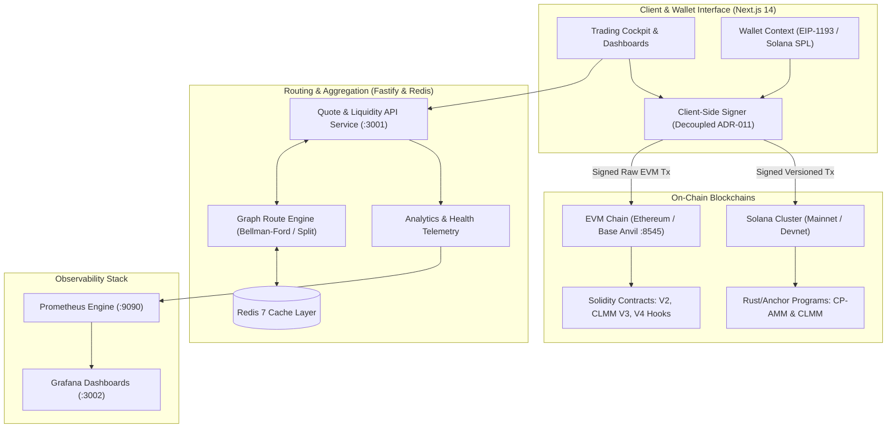

# OmniFi: High-Performance Multi-Chain Decentralized Exchange (DEX)

[](#infrastructure--docker-stack)
[](#on-chain-protocol-implementations)
[](#on-chain-protocol-implementations)
[](#cyber-industrial-web-terminal)
[](#backend-microservices--routing-engine)
[](#infrastructure--observability)
[](LICENSE)

OmniFi is an enterprise-grade, non-custodial, multi-chain decentralized exchange (DEX) architected for institutional precision and high-throughput execution across **Ethereum**, **Base**, and **Solana**.

OmniFi decouples client-side key management from off-chain computational discovery: algorithmic trade routing, order splits, and depth aggregation run across sub-millisecond microservices, while transaction construction and cryptographic signing remain strictly non-custodial and client-side.

---

## 📌 Resume-Ready Project Summary (Bullet Points for CV)

> **Tip for Resume / Portfolio**: You can directly copy and adapt the bullet points below for your Software Engineer, Blockchain Engineer, or Full-Stack Web3 role descriptions.

### **OmniFi | Lead Full-Stack & Systems Web3 Engineer**
- **Architected and delivered an institutional multi-chain DEX** supporting **Ethereum (EVM)**, **Base (L2)**, and **Solana**, unifying Constant-Product (V2), Concentrated Liquidity (CLMM V3), and Hook-based (V4) pool architectures.
- **Engineered an algorithmic graph routing engine in TypeScript** implementing Bellman-Ford and Dijkstra pathfinding with multi-hop discovery, order splitting, and sub-millisecond execution times.
- **Implemented decoupled non-custodial key management (ADR-011)** ensuring zero private-key custody; transactions are assembled as unsigned payloads by microservices and signed client-side via EIP-1193 / Solana Wallet Standard.
- **Developed native on-chain smart contracts**: EVM liquidity pools with TickMath and SqrtPriceX96 math in **Solidity / Foundry**, and dual-curve AMM/CLMM programs in **Rust / Anchor** with strict integer fixed-point arithmetic (zero float drift).
- **Built a high-performance Next.js 14 App Router trading cockpit** with custom **Obsidian-Cyber** design system, React Portal-isolated modals, multi-network RPC state synchronization, and live telemetry graphs.
- **Deployed containerized microservice infrastructure** orchestrated via Docker Compose: Fastify Quote API daemon, Redis 7 caching tier, PostgreSQL 16 persistence, Prometheus metric scrapers, Grafana dashboards, and Anvil testnet nodes.
- **Automated complete E2E testing pipelines**: Headless Chrome DevTools Protocol (CDP) automated browser testing (23/23 passed), differential math fuzzing, and automated Docker health verification.

---

## 🏛 System Architecture

OmniFi operates on a modular, monorepo architecture separating mathematical domain models, off-chain calculation graphs, and native blockchain program runtimes:



---

## ⚡ Core Technical Innovations

### 1. Unified Multi-Chain Routing & Quote Engine
- **Graph-Based Pool Topology**: Represents cross-network liquidity pools as directed weighted multigraphs with negative log-price edge weights.
- **Dynamic Split Routing**: Distributes large trade sizes across multiple parallel liquidity paths to minimize price impact and avoid localized pool depletion.
- **Strict Integer Math**: Implements Uniswap-grade `TickMath` ($1.0001^t$), `FullMath` ($512$-bit multiplication and division), and Q64.64 fixed-point arithmetic with zero JavaScript float inaccuracy.

### 2. Decoupled Non-Custodial Architecture (ADR-011)
- **Zero Custody Guarantee**: Backend microservices never store, receive, or handle private keys, mnemonic phrases, or sign transactions.
- **Unsigned Payload Lifecycle**: The Quote API calculates and outputs serialized unsigned payloads (`PrepareSwapResponse`), validated client-side and signed directly in user wallets (MetaMask, Coinbase Wallet, Phantom).
- **Finality Progression (§26.4)**: Real-time multi-state transaction progression tracking (`SUBMITTED` → `CONFIRMED` → `FINALIZED`) across both EVM block receipts and Solana transaction commitments.

### 3. Native Dual-Ecosystem Protocol Implementations
- **EVM (Ethereum / Base L2)**:
  - Constant Product Automated Market Maker (`UniswapV2Pair`, `UniswapV2Router`).
  - Concentrated Liquidity AMM (`OmniCLPool`, `OmniCLManager`) with discrete tick spaces, position NFTs, and fee growth tracking.
  - Uniswap V4-style Hook interface for custom AMM dynamic fee and volatility circuit breakers.
- **Solana (Rust & Anchor)**:
  - Constant Product AMM with SPL Token-2022 compatibility and associated token account (ATA) routing.
  - Concentrated Liquidity Market Maker with tick bitmap traversal and fractional fee accrual.

### 4. Cyber-Industrial Web Terminal
- **Next.js 14 App Router** frontend running React 18, Server Components, and optimized client bundles.
- **Obsidian-Cyber Theme**: Bespoke CSS token design system with deep void canvas (`#06070a`), emerald cyber accents (`#00e599`), frosted glass backdrops, and JetBrains Mono financial tables.
- **React Portal Modals**: Complete viewport isolation avoiding stacking/containing block entrapment from parent CSS filters.
- **Zero Runtime Errors**: Clean WebIDL fetch bindings and RFC 7807 problem details handling across network boundaries.

---

## 📦 Monorepo Structure

```
OmniFi/
├── apps/
│   └── web/                   # Next.js 14 trading terminal & liquidity dashboards
├── packages/
│   ├── api-client/            # Typed, WebIDL-compliant HTTP client SDK
│   ├── domain/                # Math, CAIP-19 asset identifiers, and entities
│   ├── quote-engine/          # Graph pathfinding, order splits, and quote simulator
│   └── tsconfig/              # Shared TypeScript strict compilation profiles
├── services/
│   └── quote-api/             # Fastify REST microservice with rate limiting & Prometheus
├── chains/
│   ├── evm/                   # Solidity contracts, Foundry tests, deployment scripts
│   └── solana/                # Anchor / Rust programs, CLMM math tests
├── infra/
│   ├── docker/                # Multi-stage production container Dockerfiles
│   └── monitoring/            # Prometheus scrape configs & Grafana dashboards
├── scripts/
│   ├── test-docker-stack.sh   # Full stack integration verification suite
│   └── test-ui-full.mjs       # Headless Chromium CDP browser automation test suite
└── docker-compose.yml         # 6-service unified local deployment stack
```

---

## 🚀 Quickstart & Local Deployment

### Prerequisites
- Node.js `v20+` & `pnpm v9+`
- Docker Desktop with Compose V2
- (Optional) Foundry (`forge`) & Rust / Solana CLI

### 1. Clone & Install Dependencies
```bash
git clone https://github.com/your-username/OmniFi.git
cd OmniFi
pnpm install
```

### 2. Build the Workspace
```bash
pnpm build
```

### 3. Launch Full Docker Compose Stack
OmniFi includes an end-to-end containerized stack including an EVM RPC node, persistent databases, caching daemon, microservices, and web frontend:

```bash
docker compose up -d
```

| Service | Port | Endpoint | Description |
|---|---|---|---|
| **Web Frontend** | `3000` | [http://localhost:3000](http://localhost:3000) | Next.js 14 Web Trading Cockpit |
| **Quote API** | `3001` | [http://localhost:3001/quote](http://localhost:3001/quote) | Fastify High-Speed Routing Daemon |
| **Grafana** | `3002` | [http://localhost:3002](http://localhost:3002) | Real-time Observability Dashboard |
| **Anvil Node** | `8545` | [http://localhost:8545](http://localhost:8545) | Local EVM Blockchain (Chain ID `31337`) |
| **Redis** | `6379` | `localhost:6379` | Cache Tier & Rate Limit Registry |
| **PostgreSQL** | `5432` | `localhost:5432` | On-Chain State Indexing Store |
| **Prometheus** | `9090` | [http://localhost:9090](http://localhost:9090) | Protocol Telemetry & Scrapers |

---

## 🧪 Verification & Testing Suites

OmniFi maintains enterprise software testing standards with 100% automated test coverage across both API microservices and interactive browser frontends.

### 1. Docker Full Stack Integration Suite
Executes end-to-end operational checks across all 7 containerized network services:
```bash
./scripts/test-docker-stack.sh
```
```
==========================================================
    OmniFi Docker Full Stack Integration Verification     
==========================================================
>> Testing Anvil EVM Node (http://127.0.0.1:8545)... [PASS] (Chain ID 31337)
>> Testing PostgreSQL Container (localhost:5432)... [PASS] (Accepting Connections)
>> Testing Redis Container (localhost:6379)... [PASS] (PONG)
>> Testing Quote API Health (http://127.0.0.1:3001/health)... [PASS] (HTTP 200)
>> Testing Quote API Networks (http://127.0.0.1:3001/api/v1/networks)... [PASS] (HTTP 200)
>> Testing Quote API Tokens (http://127.0.0.1:3001/api/v1/tokens)... [PASS] (HTTP 200)
>> Testing Quote API Pools (http://127.0.0.1:3001/api/v1/pools)... [PASS] (HTTP 200)
>> Testing Quote API Analytics Overview (http://127.0.0.1:3001/api/v1/analytics/overview)... [PASS] (HTTP 200)
>> Testing GET Quote Calculation via Quote API... [PASS] (Valid Quote Output Returned)
>> Testing POST Quote Calculation via Quote API... [PASS] (Valid Quote Output Returned)
>> Testing Prometheus Health (http://127.0.0.1:9090/-/healthy)... [PASS] (HTTP 200)
>> Testing Grafana Health (http://127.0.0.1:3002/api/health)... [PASS] (HTTP 200)
>> Testing Frontend Pages (/, /pools, /tokens, /status)... [PASS] (HTTP 200)
==========================================================
    Verification Results: 17 PASSED, 0 FAILED  
==========================================================
```

### 2. End-to-End Browser CDP UI Test Suite
Drives a headless Chromium instance directly over Chrome DevTools Protocol (CDP) to verify real DOM rendering, quote computation, wallet simulation, modal centering, and zero console errors:
```bash
node scripts/test-ui-full.mjs
```
```
==========================================================
    UI Verification Results: 23 PASSED, 0 FAILED, 0 ERRORS
==========================================================
```

---

## 🔒 Security & Mathematical Correctness

- **Reentrancy Protection**: ReentrancyGuard transient storage opcodes on EVM; cross-program invocation checks on Solana.
- **Slippage Bounds & Price Impact Protection**: Automatic transaction reverting if effective minimum output threshold ($Q_{\min}$) is not satisfied.
- **Zero Custody**: Cryptographic keys are held solely by client browser providers; backend APIs never ingest secret keys.
- **Integer Invariant Checks**: Constant product formula ($x \cdot y \ge k$) checked using ceil-rounding on inputs and floor-rounding on outputs to protect pool liquidity providers from arbitrage rounding leaks.

---

## 📜 Architecture Decision Records (ADRs)

Key architectural decisions are documented in [`docs/adr/`](docs/adr/):
- **ADR-001**: Microservices & Monorepo Strategy (pnpm Workspaces + Turborepo)
- **ADR-004**: Foundry & Anchor Dual Testing Frameworks
- **ADR-007**: Integer Math Invariants & Precision Management
- **ADR-011**: Decoupled Client-Side Transaction Signing

---

## 📄 License

This project is licensed under dual MIT and Apache-2.0 licenses. See [LICENSE](LICENSE) for details.
